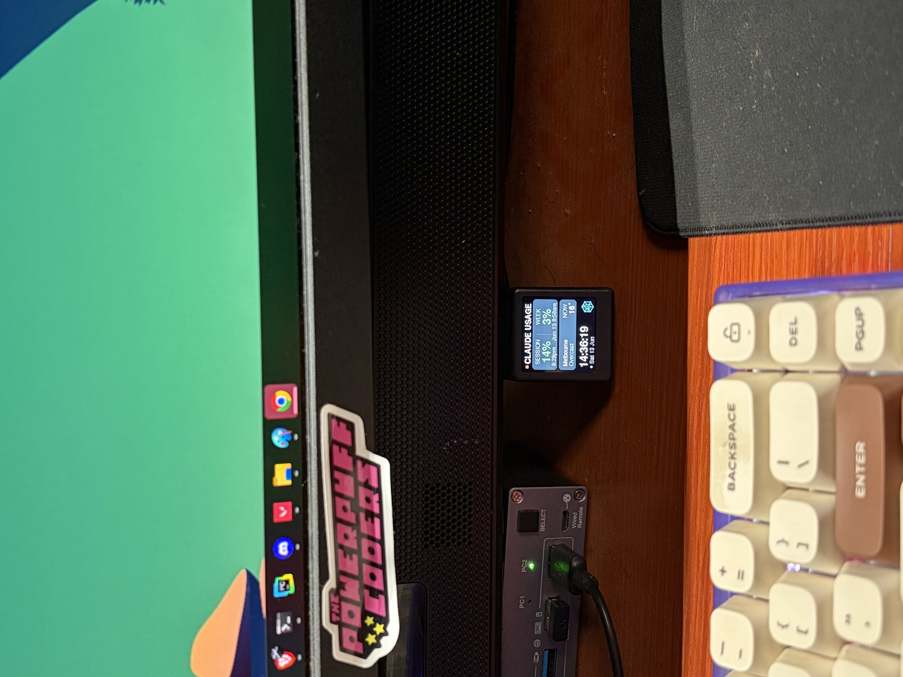
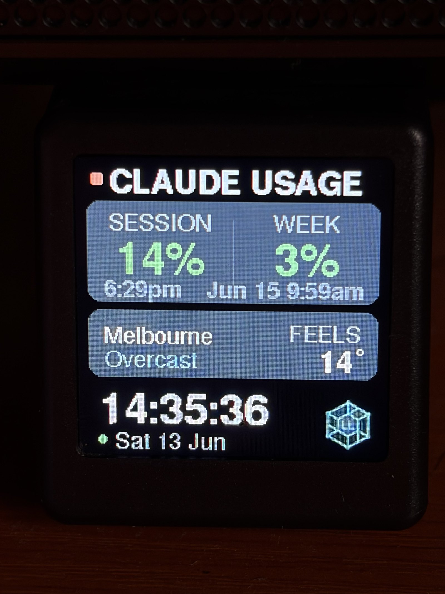

# ClaudeTV

[](https://github.com/latticelabs-au/ClaudeTV/releases/latest)
[](LICENSE)
-1E3A5F?style=flat-square&labelColor=0C1E3C)


**A tiny desk display that always shows your Claude usage** — the 5‑hour session %, 7‑day
week %, **and your model‑scoped weekly limit (e.g. Fable)** from Claude Code's `/usage`, with
reset times, plus a weather turntable and a clock. Optional **email / Discord / Slack alerts**
when a usage window resets.

On **Ultra**? Anthropic dropped the 5‑hour limit for verified Ultra accounts on 30 Oct 2026, so
an account without a session limit shows just its weekly numbers: see [Ultra accounts](#ultra-accounts-no-5-hour-limit).

Got **more than one Claude account**? The display cycles through all of them, each with its own
card and label: see [Multiple accounts](#multiple-accounts). Use **OpenAI Codex** as well? Its
usage cycles on the same screen: see [Codex accounts](#codex-accounts).

It runs on a **$15 WiFi clock** ([GeekMagic SmallTV‑Ultra on AliExpress](https://www.aliexpress.com/item/1005007937948865.html))
that you reflash **over WiFi — no soldering, fully reversible.**

<p align="center"></p>
<p align="center"></p>

> Independent open firmware for the GeekMagic SmallTV‑Ultra (stock firmware:
> [GeekMagicClock/smalltv-ultra](https://github.com/GeekMagicClock/smalltv-ultra)). Hardware ©
> GeekMagic; ClaudeTV firmware © Lattice Labs, MIT. Reflash the stock firmware any time to revert.

---

## What you need

- A **GeekMagic SmallTV‑Ultra** (the **ESP8266** model — [~$15 on AliExpress](https://www.aliexpress.com/item/1005007937948865.html)).
- An **always‑on Linux box** on your LAN (a NAS VM, a Pi, an old laptop). The device can't hold
  your Claude credentials, so this box reads your usage and feeds it to the display over your
  network.
- [**claude-swap**](https://github.com/realiti4/claude-swap) (`cswap`) on that box — the
  installer sets it up for you. It holds your Claude logins and keeps their tokens fresh,
  for **one account or a dozen**; ClaudeTV never holds a Claude token itself.
  **Claude Code is not required**: `python3 claude_usage_server.py --login` mints a login on
  a headless box, which `cswap add` then adopts.

---

## Quick start

### 1 · Set up the host (one command)

On the always‑on box:

```bash
curl -fsSL https://raw.githubusercontent.com/latticelabs-au/ClaudeTV/main/host/install.sh | bash
```

If the box doesn't have a logged‑in Claude Code install, authenticate the collector once
(open the printed URL on any device, paste the code back):

```bash
python ~/.claudetv/claude_usage_server.py --login
```

This installs the **collector + master terminal** as a systemd service (auto‑start, auto‑restart).
When it finishes it prints two URLs — your **master terminal** (`http://<host>:8088/`) and the
**Collector URL** to paste into the device (`http://<host>:8088/usage`).

### 2 · Flash the device (no build)

Grab the prebuilt image from the [latest release](https://github.com/latticelabs-au/ClaudeTV/releases/latest)
and flash it over the clock's stock web updater (find its IP on your router):

```bash
curl -F "firmware=@claudetv-v5.3.0-generic.bin" http://<device-ip>/update
```

On first boot the device opens a **`ClaudeTV-Setup`** WiFi hotspot. Join it, pick your WiFi, and
paste the **Collector URL** from step 1. Done — it finds your network and the collector and starts
displaying. Afterwards it lives at **`http://claudetv.local/`**.

That's it. Two commands and a WiFi prompt.

---

## How it works

```
 always-on host (collector, Python stdlib)             ESP8266 clock
                                                              │
   ┌─ MULTI-ACCOUNT ─────────────────────────┐                ▼
   │  cswap list --json  (claude-swap owns   │        ┌──────────────┐
   │  credentials + token keeping + polling) │        │  ClaudeTV fw │
   └─────────────────────────────────────────┘        │   /usage  ◄──┼── LAN
   ┌─ SINGLE ACCOUNT (fallback, no deps) ────┐        └──────────────┘
   │  credentials file ─► own OAuth keeper   │           cycles acc[]
   │  ─► api.anthropic.com/api/oauth/usage   │
   └─────────────────────────────────────────┘
   ┌─ CODEX (optional) ──────────────────────┐
   │  codex app-server, one CODEX_HOME per   │
   │  account (codex owns its own login)     │
   └─────────────────────────────────────────┘
        │  + open-meteo.com (weather, no key)
        ▼
   http://<host>:8088/usage   ← the device polls this  (?acct=<label> pins one)
   http://<host>:8088/        ← master terminal (accounts, status, config)
```

- **Collector** (`host/claude_usage_server.py`) serves session, week, and the model‑scoped weekly
  limit (read generically from `limits[]`, so it follows whatever model Anthropic scopes, Fable
  today) for **every account**, plus keyless weather from open‑meteo, as one small JSON. It
  **always returns the last‑good value** and backs off on rate limits, so the screen never blanks.
- **Two account backends**, chosen automatically: `cswap` when it's installed with accounts
  (multi‑account, and it owns credentials and token keeping), otherwise the built‑in
  single‑account OAuth keeper below. Nothing to configure either way.
- **Wire format is backwards compatible**: the flat `s`/`w`/`f` keys still carry the first
  account exactly as before, and `acc[]` carries the rest — so a v4.7 device keeps working
  against a multi‑account collector without reflashing.
- **Token keeper** (single‑account mode): the Claude access token is short‑lived (~8 h), but its
  refresh token's ~28‑day validity window **rolls forward on every refresh**. The collector speaks
  the OAuth refresh grant natively (same public‑client endpoint Claude Code uses) and rotates the
  pair itself every few hours, so **one login lasts indefinitely** with no Claude Code install
  needed. The master terminal shows token status and a manual *Refresh now*. In cswap mode this
  keeper **stands fully down** — cswap does the rotating, and two keepers on one token family
  would invalidate each other.
- **Firmware** (`firmware/claudetv/`) fetches that JSON over your LAN and draws it. Rendering uses
  TFT_eSPI with **one held‑open SPI transaction** (CS stays low, like the stock firmware) so there's
  **no per‑redraw coil/cap tick** — it's silent.

Your Claude token is **never logged, shown, or sent anywhere except `api.anthropic.com`.**

---

## Authentication

ClaudeTV holds **no Claude token and runs no OAuth**. [claude-swap](https://github.com/realiti4/claude-swap)
owns your logins, refreshes them, and quarantines any that genuinely die — for one account
exactly as for twelve, so there is only ever one code path and nothing that can drift.

You authenticate with your **Claude subscription login**, not an API key. Two things that
look like they should work but **don't** (save yourself the detour):

- **API keys (`sk-ant-api…`)**: the usage endpoint reports *subscription* limits (5h / 7d /
  model-scoped), which API-key accounts don't have. Wrong credential entirely.
- **`claude setup-token`** *as your only way in*: that long-lived token is scoped for Claude
  Code *inference* and is rejected (**403**) by the usage endpoint. A seat that already runs on
  one can still be shown, read from rate-limit headers instead: see
  [Setup-token seats](#setup-token-seats-no-regular-login).

If a login really does die, only that account flips to **LOGIN EXPIRED** on the display and
alerts by name; the others keep showing. Re-register it with `cswap add --alias <name>`.

> ⚠️ **Log in separately on every machine.** Refresh tokens rotate, so if two machines hold
> the *same* login (a `cswap export`/`import`, or a copied credential file) the first one to
> refresh invalidates the other's copy and that account gets quarantined. Anthropic allows
> concurrent logins — do one per box.
---

## Multiple accounts

One account, five, a dozen — all the same path. ClaudeTV reads every account from
[**claude-swap**](https://github.com/realiti4/claude-swap) (`cswap`), which owns credential
storage, token upkeep and per‑account usage polling. With more than one account the device
shows **one at a time and cycles**, so every account keeps the full three‑number card; the
header carries the account label plus page dots (or a compact `3/8` counter past six).

### 1 · Install cswap on the collector host

Any one of these, on the same always‑on box that runs the collector:

```bash
pipx install claude-swap          # recommended
uv tool install claude-swap       # if you use uv
pip install --user claude-swap    # last resort
```

Or let ClaudeTV's own installer put it in a venv beside the collector, no system Python touched:

```bash
CLAUDETV_CSWAP=1 curl -fsSL https://raw.githubusercontent.com/latticelabs-au/ClaudeTV/main/host/install.sh | bash
```

### 2 · Add each account

**For every account**, log in to Claude Code *on that host* as that account, then register it:

```bash
cswap add --alias work            # the alias becomes the display label (first 8 chars)
cswap add --alias personal
cswap add --alias client-a
cswap list                        # confirm they're all there
```

No Claude Code on the box? Mint a login with ClaudeTV's own flow first
(`python3 ~/.claudetv/claude_usage_server.py --login`, which writes
`~/.claude/.credentials.json`), then `cswap add`.

### 3 · That's it

The collector picks cswap up on its next poll — no restart, nothing to configure. Hit **Re‑read
accounts** in the master terminal if you want it immediately.

> ⚠️ **Log in separately on every machine.** Refresh tokens rotate, so if two machines hold the
> *same* login (via `cswap export`/`import`, or a copied credential file) the first one to refresh
> invalidates the other's copy and that account gets quarantined. Anthropic allows concurrent
> logins — do one per box rather than copying credentials between them.

### Managing it from the dashboards

- **Master terminal** (`http://<host>:8088/`) — the **Accounts** card shows the backend and cswap
  version, every account's S/W/scoped numbers, reset times, per‑account age and auth state, an
  inline *How to add an account* guide, a **Re‑read accounts** button, and the account filter.
- **Device panel** (`http://claudetv.local/`) — lists every account with the one currently on
  screen marked, sets **seconds per account**, and has **Show next account now**.

### Details

- **Nothing to configure**: if `cswap` is on PATH (or in `./venv/bin`) and has accounts, the
  collector uses it; otherwise it falls back to the single‑account OAuth keeper below.
- **Pick and order which accounts reach the display** with `CLAUDETV_CSWAP_ACCOUNTS=work,personal`
  (matches alias, email or slot number) — handy when cswap manages more accounts than you want on
  a 240×240 screen. Blank means all of them.
- **cswap owns the credentials** in this mode and ClaudeTV's own token keeper **stands fully
  down**, so the two never rotate the same token family against each other.
- **Per‑account everything**: a dead login takes over only *its* card (`LOGIN EXPIRED`) while the
  others keep showing, alerts are prefixed with the account label, and reset detection is keyed
  per account — so switching accounts can never be mistaken for a usage reset.
- **One device per account instead of cycling?** Point it at `/usage?acct=<label>` — that serves a
  single account, and the header reverts to the classic title.
- The firmware cycles up to **8** accounts (`MAXACC`); the collector itself has no limit.

---

## Setup-token seats (no regular login)

`claude setup-token` mints a token that lasts a year, which is how headless seats usually run
(`CLAUDE_CODE_OAUTH_TOKEN`). A regular login expires about every four weeks and cannot be renewed
without a person, so on such a seat it lapses, and cswap then reports the account as needing a
login. The token itself only carries the `user:inference` scope, and the usage endpoint answers it
**403** (`oauth_scope_insufficient`, it wants `user:profile`). Left at that, a seat that is
running work shows **LOGIN EXPIRED**.

What the token *can* do is inference, and every response carries the account's 5‑hour and weekly
utilization in its `anthropic-ratelimit-unified-*` headers. So name the seat's token **file** in
`~/.claudetv/.env` and ClaudeTV reads the seat from a 1‑token Haiku request:

```bash
CLAUDETV_CLAUDE_TOKENS=team1@example.com=/home/me/tokens/team1.token,ops@example.com=/home/me/tokens/ops.token
```

- **Which account:** the name before `=` is the cswap slot, alias or email the token belongs to.
  That account is then read through its token, whatever cswap says about its login. A name cswap
  does not have becomes a seat of its own, labelled from the name (`ops@example.com` shows as
  `OPS`; `team5` shows as `TEAM5`). No regular login is needed, kept or fallen back to.
- **A name two accounts answer to:** claude-swap lets one email sit in several orgs, and two
  accounts can share a label. A name that more than one cswap account answers to (counting
  accounts `CLAUDETV_CSWAP_ACCOUNTS` hides) binds to none of them: both read exactly as cswap reads
  them, the token shows as a seat of its own, and the master terminal says which slots matched.
  Name such a seat by its **slot** (`2=/home/me/tokens/team1.token`), which is unique.
- **Renaming:** a seat reads the account its name answers to *now*. Name it by the account's
  **email** (or slot), which a rename never changes, and it follows its account through any rename
  (in the master terminal or with `cswap alias`). A seat named by alias stops naming the account
  when the alias changes: that account then reads exactly as cswap reads it, and the token shows
  as a seat of its own under the old name until you update the line. Nothing is remembered across
  a rename, on purpose: ClaudeTV cannot tell whose token it is, so following a renamed account
  would keep a wrongly named token's numbers on it, with its own expired login hidden.
- **Name the right account:** ClaudeTV cannot check whose token it is, because a setup token cannot
  read its own profile. A token named after a cswap account shows its numbers on that account. So
  when a seat moved to a different account that cswap does not have (the old account's alias was
  `team5`, the token is now another person's), name it by that account's email, or take the old
  account out of `CLAUDETV_CSWAP_ACCOUNTS` first; `team5=` would put the new account's numbers on
  the old one, until the old account is renamed away (see Renaming).
- **No cswap needed:** token seats are read and shown even when cswap is not installed, lists no
  accounts, or fails. While cswap fails, its own accounts show exactly what they showed before the
  failure, on the display and the dashboards, as they always have; only the token seats are read.
- **What it shows:** live session and week numbers and reset times, like any account. A seat at
  its cap still reads (the API answers 429 with the same headers) and the master terminal marks it
  *blocked*. Anthropic can also refuse a seat below 100% on both windows (a per‑model or overage
  limit). The display has no *blocked* marker, so there the limit that refused it reads 100%: the
  window the headers mark as refused, else the third column, named after the limit (`OPUS`,
  `OVERAGE`, or `LIMIT` when the headers name none). The master terminal keeps the real numbers
  and says `blocked · OPUS`. The headers carry no model‑scoped weekly window apart from Fable's
  (`7d_oi`), so a token seat usually has no third (Fable) column, rather than a made‑up one.
- **No 5‑hour limit (Ultra):** an account cswap has read as having no 5‑hour limit shows its
  weekly card through its token too. A token‑only seat on such an account stays stale with its
  session at `--`: the headers carry a utilization, a reset and a status for each window they
  include, and nothing that says a window does not exist, so a missing 5‑hour window looks the
  same whether the account has none or the headers left it out.
- **When it cannot read:** a network error, a 5xx, a bare 429 or a missing token file leaves the
  seat **not dead and not 0%**. It keeps showing its last complete reading, marked stale on the
  dashboards, for two probe intervals at most (10 minutes by default, so it covers one failed
  probe), and never a window whose reset time has passed (the display has no stale marker per
  account, so an older number would pass for a live one). After that, or if it never had a
  reading, it shows `--` (its session reads `--`, never `idle`, on the display). A reading
  without both windows is stale too.
- **A rejected token:** Anthropic refusing the token itself (401, or a 403 about the credential:
  OAuth, or an invalid, expired or revoked token) shows **LOGIN EXPIRED** and alerts only once it
  has lasted **30 minutes** (at least two probes) with no answer accepting the token in between,
  with the remedy: mint a new token with `claude setup-token` and replace the file. Until then the
  seat is stale with `token_rejected`. When every token seat is refused at once, which points at
  a fault at Anthropic rather than at that many revoked tokens, it waits **4 hours** instead, and
  the alert says so. A probe that gets no answer about the token (network error, 5xx, bare 429,
  an edge page) neither restarts that count nor ends a LOGIN EXPIRED; only an answer that accepts
  the token does.
- **Retry‑After:** when Anthropic answers with `Retry-After` (a seat at its weekly cap gets about
  two days), the seat is not probed again until then, for an hour at most so an early reset still
  shows; **Re‑read accounts** does not override it. Meanwhile the seat keeps showing its capped
  reading (not `--`, not 0%, not dead, and no alert), except a window whose reset passes during
  the wait, which reads `--` until the next probe.
- **A retired model:** if `CLAUDETV_TOKEN_MODEL` answers 404, ClaudeTV asks the token which models
  it may use and probes the newest Haiku instead until the next restart, so the seats keep
  reading. Set the line to a current model to make it stick.
- **Fleet alert:** "every account is out of quota" stays cswap's own verdict, judged on what cswap
  itself reads for each account. Room on a seat only helps if cswap can switch onto it, and cswap
  cannot use a lapsed login however much room its token shows, so token readings can neither raise
  nor clear that alert. A token-only seat is not in cswap's rotation at all.
- **Alerts:** a seat's token readings keep their own reset history, so moving a seat onto its token
  does not replay resets that happened while its login was lapsed.
- **Cost and pace:** one request per seat every `CLAUDETV_TOKEN_EVERY` seconds (300 by default,
  120 at least). **Re‑read accounts** re‑probes at most once a minute. Two costs come with every
  probe, and you accept them by naming a token:
  - **each probe sends Claude Code's system prompt.** Anthropic only takes an OAuth inference
    request that carries it; without it the API answers 429 with no usage headers, so there would
    be nothing to read.
  - **each probe is a small amount of real usage on that seat** (a 1‑token Haiku request),
    counted against that seat's own 5‑hour and weekly limits like any other request.
- **Safety:** the line takes token **file paths** only (`~` for your home directory works), so it
  points at the token files you already have and never holds a copy of a token. An entry that
  holds a token itself is ignored, with a log line that names the entry by its position and never
  shows what it holds. Only a file that holds exactly one OAuth token (`sk-ant-oat…`) is ever
  sent, only to `api.anthropic.com` (a redirect is never followed), and the token is never stored,
  logged or served. The master terminal cannot show or change the line. A setup token has no
  refresh token, so reading it never rotates or expires anything.

---

## Codex accounts

Use OpenAI **Codex** on a ChatGPT plan too? Its usage shows up on the same display: a Codex
account gets the same card and cycles alongside your Claude accounts, tagged `codex` in the
master terminal. It is optional, and a Claude-only setup behaves exactly as before.

**What it needs:** the official [`codex` CLI](https://github.com/openai/codex) on the collector
host, logged in. Nothing else to install. ClaudeTV asks Codex itself for the numbers
(`codex app-server`, the same interface the Codex IDE extension uses), so **ClaudeTV never holds
a Codex token**, and Codex keeps its own login fresh.

**Accounts:**

- The login in `~/.codex` on the collector host is picked up automatically.
- For each extra account, run this in your own shell on that host (it wraps `codex login`
  in a private folder under `~/.claudetv/codex/<name>`):

  ```bash
  python3 ~/.claudetv/claude_usage_server.py --codex-login work
  ```

  The name becomes the label on the display (first 8 characters).

> ⚠️ **Log in separately on every machine.** Never copy a Codex folder from another box.
> Refresh tokens rotate, so the first machine to refresh invalidates the other's copy.

**On the display:** Codex accounts are **violet** where Claude accounts are coral (header, label
and their page dots), so a mixed fleet reads at a glance. A single Codex-only setup gets a
`CODEX USAGE` title. This needs firmware **v5.2**; an older device still cycles Codex accounts,
just in coral and with the classic card.

**Renaming:** every account row in the master terminal has a **rename** link, for Claude and Codex
alike. A Claude name is a claude-swap alias, so the terminal simply runs `cswap alias` for you; a
Codex name is kept by ClaudeTV (`CLAUDETV_CODEX_LABELS`). The display shows the first 8 characters,
a blank name puts the default back, and a rename never touches reset history or alert state.

**Good to know:**

- OpenAI decides which limits a plan has. Some plans currently report only a weekly limit. Those
  accounts get a **WEEK** card instead of a dead session column: a single number, or
  **WEEK | MODEL** with one shared reset line when `CLAUDETV_CODEX_SCOPED` picks a model limit.
  If your plan has a 5-hour limit too, you get the usual columns.
- **Several Codex accounts** work the same way as several Claude accounts: one folder each, they
  cycle after the Claude ones in folder order, each with its own reset history and alerts, up to
  8 accounts in total on the screen. To pin a second device to one of them use its key, which
  stays unambiguous even if a Claude alias shares the name: `/usage?acct=codex:work`.
- **Dead login:** if OpenAI rejects a Codex login, you get one alert on your configured channels
  with the exact command to run, and only that account's card flips to **LOGIN EXPIRED** while
  the others keep cycling. One more alert confirms the recovery after you log in again.
- **Every Codex account out of quota** raises its own alert, judged from OpenAI's own "blocked"
  verdict first and `CLAUDETV_CODEX_MAXED_THRESHOLD` second. Claude and Codex are judged
  separately, since one cannot stand in for the other.
- This reads a private OpenAI endpoint through the official client, politely: one request per
  account every five minutes (`CLAUDETV_CODEX_EVERY`, 300 s minimum), with plugins disabled so
  a read is a single request.
- On a Pi-class host the `codex` binary is large (about 260 MB), so the first read after boot
  can take a few seconds off an SD card. `CLAUDETV_CODEX_TIMEOUT` (default 20 s) covers it.

| Setting | Default | Meaning |
|---|---|---|
| `CLAUDETV_CODEX_BIN` | auto | path to `codex` (auto: `~/.local/bin/codex`, else PATH) |
| `CLAUDETV_CODEX_ACCOUNTS` | all | comma list of folder names that filters and orders (`default` is `~/.codex`) |
| `CLAUDETV_CODEX_EVERY` | `300` | seconds between polls, 300 minimum |
| `CLAUDETV_CODEX_TIMEOUT` | `20` | hard deadline for one read |
| `CLAUDETV_CODEX_SCOPED` | off | part of a model limit's name to show as an extra number (for example `spark`): the third on a plan with a 5-hour limit, the second on a weekly-only plan |
| `CLAUDETV_CODEX_MAXED_THRESHOLD` | `100` | percent at which an account counts as out |
| `CLAUDETV_CODEX_LABELS` | none | display names set from the terminal, `folder=Name` pairs (`default=Astra,work=Team`) |

---

## Ultra accounts (no 5-hour limit)

On 30 Oct 2026 Anthropic renamed Max 20x to **Ultra** and removed the 5‑hour session limit for
**verified** Ultra accounts ([what is the Ultra plan?](https://support.claude.com/en/articles/17728952-what-is-the-ultra-plan)).
Anthropic verifies accounts automatically; newer ones keep the 5‑hour limit until it does. The
weekly limit and the model‑scoped weekly (Fable) still apply.

For such an account the usage API reports no `five_hour` window, and `cswap list --json` simply
omits `fiveHour`. From v5.3 ClaudeTV reads that as **an account with no session limit**, not as a
partial reading:

- **Display:** the card shows **WEEK | FABLE** with one shared reset line (or a single WEEK hero
  when there is no model limit). The master terminal shows *no 5h limit* in place of `S`, and the
  device's own web panel shows the session as `none`.
- **Alerts:** weekly resets alert (before v5.3 this account sent none); there is no session window to alert on. If the
  5‑hour window ever comes back, it starts fresh rather than being compared with an old reading.
- **Fleet:** "every account is out of quota" judges the account on its weekly window, the same
  way cswap's auto‑switch does.
- **Wire:** the account carries `"nos": 1` (no session) with `s: -1`. A v5.2 device keeps working
  against a v5.3 collector: it ignores `nos` and keeps the session column for that account, drawn
  as `--` with `idle` under it. Flash v5.3 for the new card.

Only a reading from the usage endpoint counts. When cswap read an account through its rate‑limit
header probe (`"source": "headers"` in `cswap list --json`), a missing `fiveHour` only means the
headers did not carry that window, and cswap treats the reading as incomplete; so does ClaudeTV,
which keeps it stale. An account that reports a 5‑hour window but no weekly one (claude‑swap names
Team and Enterprise seats) is also still stale, as before.

Before v5.3 the collector treated a verified Ultra account as a partial reading. Its numbers kept
updating, but the master terminal tagged it stale, it never sent a reset alert, and it counted as
unknown, which held back the fleet verdict. Updating the collector fixes all three.

---

## Features

- **Three hero numbers** — S (5h session) | W (7d week) + F (model‑scoped weekly, e.g. **Fable**),
  green/amber/red by level. Week and the scoped limit share one reset line (same 7‑day window);
  accounts without a scoped limit automatically get the classic two‑column card.
- **Ultra accounts (no 5‑hour limit)**: a verified Ultra account shows **WEEK | FABLE** with one
  reset line, or WEEK alone, instead of a dead session column. See
  [Ultra accounts](#ultra-accounts-no-5-hour-limit) above.
- **Reset alerts** — get pinged by **email, Discord, and Slack** the moment a usage window
  (5‑hour session and/or 7‑day week) rolls over to a fresh quota — the reset Anthropic only posts
  on X. Configure it in the master terminal's Notifications card; secrets are write‑only and each
  channel has a Test button.
- **Auth outage: on‑screen + alerted + self‑healing**: if the Claude login dies the card flips
  to a red **LOGIN EXPIRED / re‑auth on host** state instead of silently showing stale numbers,
  an alert goes out on your configured channels, and if you've set up a standby login the
  collector fails over to it automatically and keeps the display live.
- **Weather turntable** — cycles now / feels‑like / high / low / rain % / humidity.
- **Clock** + auto‑dimming **night mode** (default 30 %, 21:00–07:00, configurable).
- **Device control panel** (`http://claudetv.local/`) — brightness, night mode, flip display,
  refresh interval, collector URL, reboot, OTA, and a link to the master terminal.
- **Master terminal** (`http://<host>:8088/`) — live status, **city search** (sets location +
  timezone automatically), token keeper, service control, device link.
- **In‑app firmware updates** — the master terminal checks GitHub, downloads the release and
  flashes the device over your LAN in one click. The device shows a small cyan marker when an
  update is waiting, so you notice without opening anything. No cable, no manual download.
- **Knows when you are actually blocked** — with auto‑switching, one account capping is a
  non‑event (cswap moves to another). ClaudeTV alerts only when **every** account is out,
  judged against cswap's own `autoswitch.threshold` so the two never disagree.
- **Emulator** (`emulator/index.html`) — a 240×240 browser preview that pulls live collector data
  and positions text with the **device's real GFX font advance tables**, so string widths match the
  ESP render exactly — tweak the layout without reflashing.

---

## Build from source (optional)

If you'd rather build the firmware yourself instead of using the release image:

1. `cp firmware/claudetv/config.h.example firmware/claudetv/config.h` and fill in your WiFi + the
   collector URL.
2. Copy `firmware/User_Setup.h` over your TFT_eSPI library's `User_Setup.h`.
3. Build with the ESP8266 Arduino core (libs: TFT_eSPI, ArduinoJson, WiFiManager):
   ```bash
   arduino-cli compile --fqbn esp8266:esp8266:generic:eesz=4M1M --output-dir build firmware/claudetv
   ```
4. Flash: `curl -F "firmware=@build/claudetv.ino.bin" http://<device-ip>/update`

To run the collector from a clone instead of the curl installer: `cd host && sudo bash install.sh`.

---

## Hardware (ESP‑12F / ST7789V 240×240)

| Signal | GPIO | | Signal | GPIO |
|---|---|---|---|---|
| MOSI | 13 | | CS | 15 |
| SCLK | 14 | | DC | 0 |
| RST | 2 | | Backlight | 5 (active‑low PWM) |

The stock `/update` endpoint is a plain `ESP8266HTTPUpdateServer`, which is why custom firmware
flashes over the air and the stock firmware re‑flashes the same way. The backlight is PWM'd at
22 kHz — never DC‑drive it at 100 % (it overheats the boost converter).

## License

MIT — see [LICENSE](LICENSE). Built by [Lattice Labs](https://latticelabs.au).
